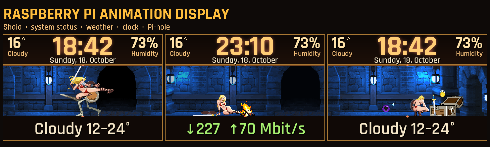
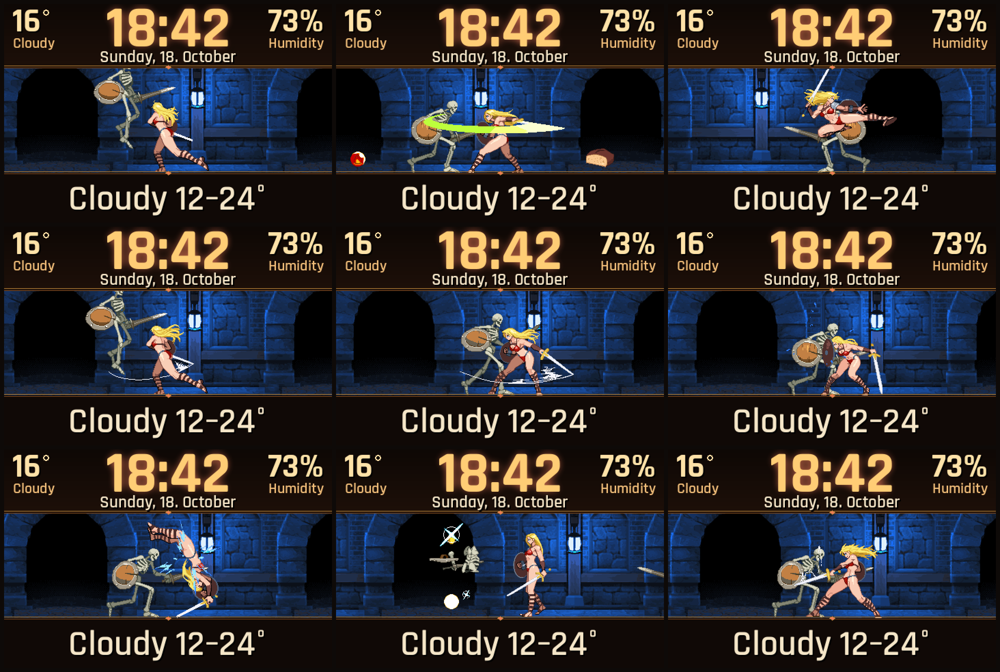

# Raspberry Pi Animation Display – Shaia

**Animated pixel-art display for the Raspberry Pi and Pi-hole: system status, weather and clock, with the heroine Shaia fighting in a dungeon.**

Made for a Raspberry Pi that runs [Pi-hole](https://pi-hole.net/). A 3.5" SPI display shows the clock, date, weather, internet status and the Pi-hole statistics (blocked requests today), while Shaia fights skeletons in a scrolling dungeon. Blocked Pi-hole requests feed a bounded skeleton queue; occasional bonus skeletons also appear. It is written in Rust (in [`rust/`](rust/PLAN.md)): one binary, no Python.

*Deutsch:* Animierte Pixel-Art-Anzeige für den Raspberry Pi mit Pi-hole und 3,5-Zoll-SPI-Display: Uhr, Datum, Wetter, Internetstatus und Pi-hole-Statistik, dazu Heldin Shaia im Dungeon. Jede von Pi-hole geblockte Werbeanfrage schickt ein Skelett. Geschrieben in Rust, eine einzelne Binärdatei ohne Python.

## What it shows

| Area | Content |
|---|---|
| Top bar | Large clock, date, temperature + weather word, humidity |
| Bottom line | One big rotating line every 4 s: weather, feels-like/wind/UV, ping, down/up Mbit/s, Pi-hole blocked count, CPU temperature, uptime. Weather warnings come first, `OFFLINE since hh:mm` overrides everything |
| Scene | Shaia in a scrolling dungeon hall. Each blocked request spawns a skeleton (some jump at her). Magic orbs fly in: she ducks, jumps or blocks from the front and gets hit from behind. Loot drops, a chest on the far right is opened now and then, a fixed campfire at night. Touch = jump |

The display language is German by default; set `PI_SPRACHE=en` in the service environment for English.

## Screenshots

Combat moments:

## Hardware and stack

- Raspberry Pi 4 (8 GB), Raspberry Pi OS Lite (Trixie, 64-bit), Pi-hole v6 on the same Pi
- 3.5" SPI display, ILI9486, 480×320, touch ADS7846 (`dtoverlay=piscreen,drm,speed=32000000`)
- Rust 1.85+, native DRM/KMS output with `/dev/fb0` fallback, bundled SQLite, PNG assets and TrueType fonts
- systemd service for the display and a timer for the speed test
- Data: [Open-Meteo](https://open-meteo.com/) (weather, no key), Cloudflare speed test (`speed.cloudflare.com`), Pi-hole FTL database (read-only)

Only the changed rows of the frame are sent over SPI, which keeps scrolling smooth at 32 MHz.

## Resource use (measured on the Pi, 20 Oct 2026)

| Measure | Value |
|---|---|
| CPU of the display process | about 7-9 % of one core, 24 fps |
| RAM | about 40 MB resident (0.5 % of 8 GB) |
| Binary | about 6 MB |
| SoC temperature | about 62-64 °C with passive cooling, together with Pi-hole |
| Speed test | about 15 s every 3 h (timer), negligible |

The throttling flag of the Pi can report under-voltage and throttling events since boot. Use a proper 5 V / 3 A power supply.

## Build and install

Build with Rust 1.85 or newer: `cd rust && cargo build --release --locked`.
On a passively cooled Pi, use `nice -n 19 taskset -c 3 cargo build --release --locked` (a build on all cores heats the Pi to about 83 °C).

1. Flash Raspberry Pi OS Lite, enable SSH, install Pi-hole if wanted.
2. Enable the display overlay in `/boot/firmware/config.txt` (`dtoverlay=piscreen,drm,speed=32000000`).
3. Copy `target/release/shaia-display` and `target/release/speedtest` to `/opt/pi-anzeige/`, install `rust/pi-shaia.service`, `rust/pi-speedtest.service` and `rust/pi-speedtest.timer`, then `systemctl enable --now pi-shaia pi-speedtest.timer`. The service runs as `anzeige` with the `video`, `pihole` and `input` groups; these accounts/groups must exist.
4. Download the artwork yourself (see below). Copy the `sprites` folder of the Shaia package to `/opt/pi-anzeige/assets/shaia` (it must contain `shaia`, `skeleton`, `vfx`, `prop`, `item`, `background`), or set `PI_ASSETS` to your assets folder. Without the artwork the program prints where to get it and exits. Copy the font files of this repo to `/opt/pi-anzeige/assets/fonts`; missing fonts fall back to DejaVu (`fonts-dejavu-core`).

The style is chosen by the single word in `stil.txt` (`glut` is the default dungeon look; `klar`, `v7`, `retro` also exist; a missing file selects `klar`). Set `PI_SPRACHE=en` for English texts.
Plan, measurements and review notes are in [`rust/PLAN.md`](rust/PLAN.md).

## Artwork – not included, please download it yourself

The repository contains **only code**. The graphics belong to their authors and have to be downloaded from the original pages:

- **Shaia – Ruin Runners (character, skeleton, dungeon, items, effects)** by **picopico256**: <https://picopico256.itch.io/shaia-ruin-runnerscharacter>. Free, usable privately and commercially, but **the graphic files must not be redistributed**, so they are not part of this repo. Many thanks to picopico256 for the beautiful sprites and animations.

Fonts (SIL Open Font License, from Google Fonts): [Rajdhani](https://fonts.google.com/specimen/Rajdhani), [Saira Condensed](https://fonts.google.com/specimen/Saira+Condensed), [Silkscreen](https://fonts.google.com/specimen/Silkscreen), [JetBrains Mono](https://fonts.google.com/specimen/JetBrains+Mono).

## Thanks

picopico256 (Shaia), the Pi-hole team, Open-Meteo and Cloudflare for the free speed endpoint.

## Roadmap

- **Done:** Rust implementation (a single binary, no Python), 7-9 % of one core, about 40 MB RAM
- **Ideas:** thread watchdog, display re-connect, Rust-only test images for the README

## License

Code: MIT, see [LICENSE](LICENSE). Artwork and fonts keep their own licenses as listed above; the artwork is not part of this repository.
