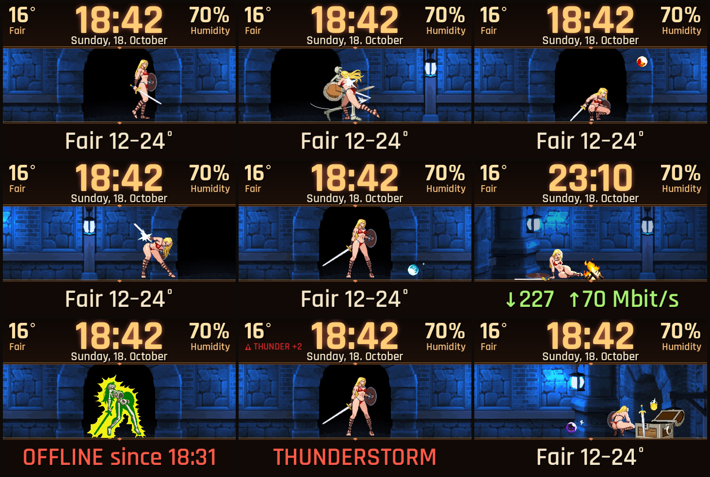

# Raspberry Pi Animation Display – Shaia

**Animated pixel-art display for the Raspberry Pi and Pi-hole: system status, weather and clock, with the heroine Shaia fighting in a dungeon.**

Made for a Raspberry Pi that runs [Pi-hole](https://pi-hole.net/). A 3.5" SPI display shows the clock, date, weather, internet status and the Pi-hole statistics (blocked requests today), while Shaia fights skeletons in a scrolling dungeon. Every ad that Pi-hole blocks sends a skeleton. Version 1 is written in Python, a Rust rewrite is planned.

*Deutsch:* Animierte Pixel-Art-Anzeige für den Raspberry Pi mit Pi-hole und 3,5-Zoll-SPI-Display: Uhr, Datum, Wetter, Internetstatus und Pi-hole-Statistik, dazu Heldin Shaia im Dungeon. Jede von Pi-hole geblockte Werbeanfrage schickt ein Skelett. Version 1 ist in Python, eine Rust-Version ist geplant.

## What it shows

| Area | Content |
|---|---|
| Top bar | Large clock, date, temperature + weather word, humidity |
| Bottom line | One big rotating line every 4 s: weather, feels-like/wind/UV, ping, down/up Mbit/s, Pi-hole blocked count, CPU temperature, uptime. Weather warnings come first, `OFFLINE since hh:mm` overrides everything |
| Scene | Shaia in a scrolling dungeon hall. Each blocked request spawns a skeleton (some jump at her). Magic orbs fly in: she ducks, jumps or blocks from the front and gets hit from behind. Loot drops, a chest on the far right is opened now and then, a fixed campfire at night. Touch = jump |

The display language is German by default; set `PI_SPRACHE=en` in the service environment for English.

## Hardware and stack

- Raspberry Pi 4 (8 GB), Raspberry Pi OS Lite (Trixie, 64-bit), Pi-hole v6 on the same Pi
- 3.5" SPI display, ILI9486, 480×320, touch ADS7846 (`dtoverlay=piscreen,drm,speed=32000000`)
- Python 3.13, Pillow, numpy, `python3-kms++` (direct DRM/KMS output, fallback `/dev/fb0`), fontTools
- systemd services and a timer for the speed test
- Data: [Open-Meteo](https://open-meteo.com/) (weather, no key), Cloudflare speed test (`speed.cloudflare.com`), Pi-hole FTL database (read-only)

Only the changed rows of the frame are sent over SPI, which keeps scrolling smooth at 32 MHz.

## Resource use (measured on the Pi, 18 Oct 2026)

| Measure | Value |
|---|---|
| CPU of the scene process | about 27 % of one core (≈ 7 % of the whole Pi), 24 fps |
| RAM | about 90 MB resident (1.1 % of 8 GB) |
| Installed size | 4.8 MB code and assets |
| SoC temperature | about 67 °C with passive cooling, running together with Pi-hole |
| Speed test | a few seconds every 3 h (timer), negligible |

The throttling flag of the Pi reported earlier under-voltage and throttling events since boot, none at the time of measurement. Use a proper 5 V / 3 A power supply.

## Install (short)

1. Flash Raspberry Pi OS Lite, enable SSH, install Pi-hole if wanted.
2. Enable the display overlay in `/boot/firmware/config.txt`.
3. `sudo apt install python3-pil python3-numpy python3-kms++ python3-fonttools`
4. Download the artwork yourself (see below). Copy the `sprites` folder of the Shaia package to `/opt/pi-anzeige/assets/shaia` (it must contain `shaia`, `skeleton`, `vfx`, `prop`, `item`, `background`), or set `PI_ASSETS` to your assets folder. Without the artwork the program prints where to get it and falls back to the plain text display. Missing fonts fall back to DejaVu.
5. Copy the files to `/opt/pi-anzeige`, install the `pi-*.service` / `pi-speedtest.timer` units, start `pi-ruinrunner`.

The style is chosen by the single word in `stil.txt` (`glut` is the default dungeon look).

## Artwork – not included, please download it yourself

The repository contains **only code**. The graphics belong to their authors and have to be downloaded from the original pages:

- **Shaia – Ruin Runners (character, skeleton, dungeon, items, effects)** by **picopico256**: <https://picopico256.itch.io/shaia-ruin-runnerscharacter>. Free, usable privately and commercially, but **the graphic files must not be redistributed**, so they are not part of this repo. Many thanks to picopico256 for the beautiful sprites and animations.

Fonts (SIL Open Font License, from Google Fonts): [Rajdhani](https://fonts.google.com/specimen/Rajdhani), [Saira Condensed](https://fonts.google.com/specimen/Saira+Condensed), [Silkscreen](https://fonts.google.com/specimen/Silkscreen), [JetBrains Mono](https://fonts.google.com/specimen/JetBrains+Mono).

## Thanks

picopico256 (Shaia), the Pi-hole team, Open-Meteo, Cloudflare for the free speed endpoint, and the authors of Pillow, numpy and libkms++.

## Roadmap

- **v1 (this repo):** Python
- **v2:** Rust rewrite, lower CPU and memory use, same look

## License

Code: MIT, see [LICENSE](LICENSE). Artwork and fonts keep their own licenses as listed above; the artwork is not part of this repository.
